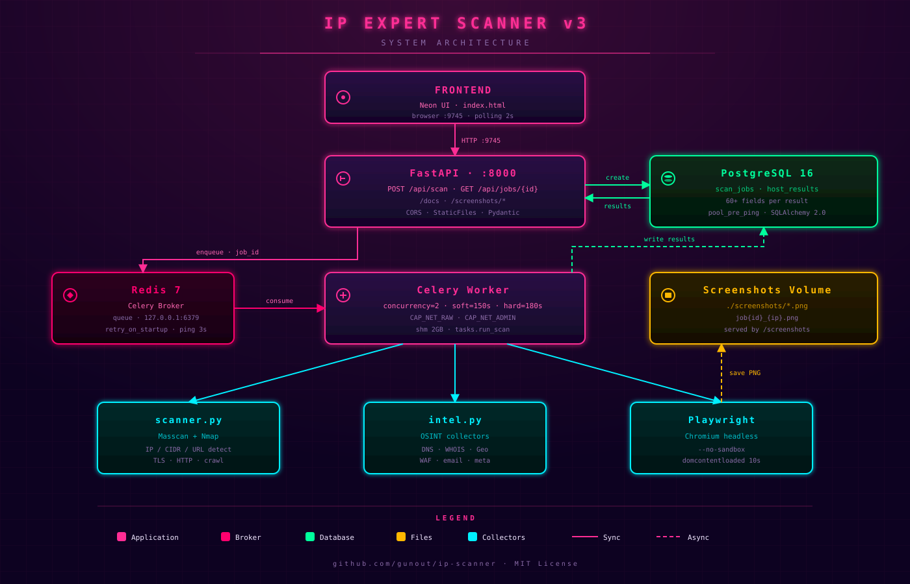
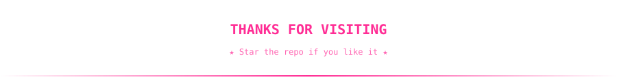

<!-- ============================================================ -->
<!--  IP EXPERT SCANNER v3 — PROFESSIONAL README                  -->
<!--  Repo: github.com/gunout/ip-scanner                          -->
<!--  Theme: Neon Rose (FF2D95) + Cyber Cyan (00F0FF)             -->
<!-- ============================================================ -->

<p align="center">
  
</p>

<p align="center">
  <a href="https://github.com/gunout/ip-scanner">
    
  </a>
</p>

<p align="center">
  <a href="https://github.com/gunout/ip-scanner">
    
  </a>
</p>

<p align="center">
  
</p>

<p align="center">
  
</p>

<p align="center">
  
  
  
  
  
</p>

<p align="center">
  
</p>

<h2 align="center">⚡ <code>whatami</code></h2>

<p align="center">
  <samp>
    <span style="color:#FF2D95;font-size:16px;">🎯 Full-Stack Network & Web Recon Scanner</span><br><br>
    <span style="color:#FF2D95;">🌍 Network</span> — Masscan + Nmap hybrid · IP / CIDR / URL auto-detect<br>
    <span style="color:#FF69B4;">🔒 TLS</span> — Certificate chain, cipher, SAN, expiration, ssl-enum-ciphers<br>
    <span style="color:#FFB6D9;">🌐 Web</span> — Headers, redirect chain, HTTP/2, compression, cookies<br>
    <span style="color:#FF2D95;">🛡️ Security</span> — 7 headers weighted score /75 + sensitive paths<br>
    <span style="color:#FF69B4;">🌍 DNS</span> — A, AAAA, MX, NS, TXT, CNAME, SOA, CAA, SRV, DNSSEC, SPF, DKIM<br>
    <span style="color:#FFB6D9;">📧 Email</span> — SPF, DMARC, DKIM detection + score /3<br>
    <span style="color:#FF2D95;">🔎 OSINT</span> — WHOIS, Geo/ASN, subdomains (crt.sh), favicon hash<br>
    <span style="color:#FF69B4;">🔥 WAF/CDN</span> — Cloudflare, Akamai, AWS, Fastly, Sucuri, Imperva…<br>
    <span style="color:#FFB6D9;">📄 Meta</span> — Title, description, OG, Twitter, JSON-LD, emails, social<br>
    <span style="color:#FF2D95;">🕷️ Crawl</span> — Internal links (max 50) · AXFR zone transfer test<br>
    <span style="color:#FF69B4;">📸 Screenshot</span> — Playwright headless · clickable thumbnails<br>
    <span style="color:#FFB6D9;">🎨 UI</span> — Neon rose glow · SVG animations · real-time polling
  </samp>
</p>

<p align="center">
  
</p>

<h2 align="center">🛠️ <code>tech_stack</code></h2>

<p align="center">
  
  
  
  
</p>

<p align="center">
  
  
  
  
</p>

<p align="center">
  
  
  
  
</p>

<p align="center">
  
  
  
  
</p>

<p align="center">
  
</p>

<h2 align="center">✨ <code>features_matrix</code></h2>

<p align="center">
  
  
  
</p>

<table align="center">
  <tr>
    <th align="center">Collector</th>
    <th align="center">v2</th>
    <th align="center">v3</th>
  </tr>
  <tr><td>Masscan + Nmap (IP/CIDR)</td><td>✅</td><td>✅</td></tr>
  <tr><td>Nmap OS detection (-O)</td><td>❌</td><td>✅</td></tr>
  <tr><td>TLS certificate (subject/issuer/SAN)</td><td>✅</td><td>✅</td></tr>
  <tr><td>TLS cipher + chain + ssl-enum-ciphers</td><td>❌</td><td>✅</td></tr>
  <tr><td>HTTP headers raw dump</td><td>❌</td><td>✅</td></tr>
  <tr><td>Redirect chain full</td><td>❌</td><td>✅</td></tr>
  <tr><td>HTTP/2 detection (ALPN)</td><td>❌</td><td>✅</td></tr>
  <tr><td>Compression + Cache-Control</td><td>❌</td><td>✅</td></tr>
  <tr><td>7 security headers score /75</td><td>✅</td><td>✅</td></tr>
  <tr><td>Cookies analysis (Secure/HttpOnly/SameSite)</td><td>✅</td><td>✅</td></tr>
  <tr><td>Sensitive paths probe</td><td>✅</td><td>✅</td></tr>
  <tr><td>DNS A/AAAA/MX/NS/TXT/CNAME/SOA</td><td>✅</td><td>✅</td></tr>
  <tr><td>DNS CAA + SRV</td><td>❌</td><td>✅</td></tr>
  <tr><td>DNSSEC (DNSKEY)</td><td>❌</td><td>✅</td></tr>
  <tr><td>Zone transfer AXFR test</td><td>❌</td><td>✅</td></tr>
  <tr><td>SPF / DMARC / DKIM detection</td><td>❌</td><td>✅</td></tr>
  <tr><td>Email security score /3</td><td>❌</td><td>✅</td></tr>
  <tr><td>WHOIS (registrar/dates/NS)</td><td>✅</td><td>✅</td></tr>
  <tr><td>Subdomains via crt.sh</td><td>❌</td><td>✅</td></tr>
  <tr><td>GeoIP + ASN + ISP</td><td>✅</td><td>✅</td></tr>
  <tr><td>Reverse DNS</td><td>✅</td><td>✅</td></tr>
  <tr><td>WAF detection (8+ signatures)</td><td>❌</td><td>✅</td></tr>
  <tr><td>CDN detection</td><td>❌</td><td>✅</td></tr>
  <tr><td>Technologies (30+ signatures)</td><td>✅</td><td>✅</td></tr>
  <tr><td>Meta / OG / Twitter tags</td><td>❌</td><td>✅</td></tr>
  <tr><td>Emails extraction</td><td>❌</td><td>✅</td></tr>
  <tr><td>Social links</td><td>❌</td><td>✅</td></tr>
  <tr><td>Favicon hash (Shodan)</td><td>❌</td><td>✅</td></tr>
  <tr><td>HTML stats (forms/scripts/iframes)</td><td>❌</td><td>✅</td></tr>
  <tr><td>JSON-LD structured data</td><td>❌</td><td>✅</td></tr>
  <tr><td>robots.txt</td><td>✅</td><td>✅</td></tr>
  <tr><td>security.txt (RFC 9116)</td><td>❌</td><td>✅</td></tr>
  <tr><td>sitemap.xml</td><td>❌</td><td>✅</td></tr>
  <tr><td>Crawl internal links</td><td>✅</td><td>✅</td></tr>
  <tr><td>Screenshot Playwright</td><td>✅</td><td>✅</td></tr>
</table>

<p align="center">
  
</p>

<h2 align="center">🔍 <code>collectors_v3</code></h2>

<h3 align="center">🌍 Network Scanning</h3>
<p align="center">
  
  
  
</p>

<h3 align="center">🌐 Web & HTTP</h3>
<p align="center">
  
  
  
  
</p>

<h3 align="center">🔒 TLS / SSL</h3>
<p align="center">
  
  
  
  
</p>

<h3 align="center">🌍 DNS Advanced</h3>
<p align="center">
  
  
  
  
</p>

<h3 align="center">📧 Email Security</h3>
<p align="center">
  
  
  
  
</p>

<h3 align="center">🛡️ Security Headers</h3>
<p align="center">
  
  
  
  
</p>

<h3 align="center">🔥 WAF / CDN Detection</h3>
<p align="center">
  
  
  
  
  
  
  
  
</p>

<h3 align="center">🔎 OSINT</h3>
<p align="center">
  
  
  
  
  
</p>

<h3 align="center">📄 Content Analysis</h3>
<p align="center">
  
  
  
  
  
</p>

<h3 align="center">📜 Standard Files</h3>
<p align="center">
  
  
  
</p>

<h3 align="center">🕷️ Crawl & 📸 Screenshot</h3>
<p align="center">
  
  
  
</p>

<p align="center">
  
</p>

<h2 align="center">🎯 <code>scan_modes</code></h2>

<p align="center">
  <samp>
    <span style="color:#FF2D95;font-size:15px;">⚡ fast</span> — Masscan only · very fast · no service detection<br>
    <span style="color:#FF69B4;font-size:15px;">⚖ balanced</span> — Masscan + Nmap -sV · recommended for general use<br>
    <span style="color:#FFB6D9;font-size:15px;">🔬 deep</span> — Nmap -sV -O · maximum precision · OS detection<br>
    <span style="color:#FF2D95;font-size:15px;">🧠 smart</span> — Prioritize known IPs (7-day history)<br>
    <span style="color:#FF69B4;font-size:15px;">🌐 url</span> — Full web recon · auto-selected for URLs
  </samp>
</p>

<p align="center">
  
  
  
  
</p>

<p align="center">
  
</p>

<h2 align="center">📊 <code>scoring_systems</code></h2>

<p align="center">
  <samp>
    <span style="color:#FF2D95;">🛡️ Security Score /75</span><br>
    HSTS (15) · CSP (20) · X-Frame (10) · X-Content-Type (10)<br>
    Referrer-Policy (8) · Permissions-Policy (7) · X-XSS (5)<br><br>
    <span style="color:#00FF9D;">0-24 → 🔴 critical</span><br>
    <span style="color:#FFB800;">25-49 → 🟠 moderate</span><br>
    <span style="color:#00FF9D;">50-75 → 🟢 good</span><br><br>
    <span style="color:#FF69B4;">📧 Email Score /3</span><br>
    SPF hardfail/softfail (1) · DMARC quarantine/reject (1) · DKIM present (1)
  </samp>
</p>

<p align="center">
  
</p>

<h2 align="center">🏗️ <code>architecture</code></h2>

<p align="center">
  
</p>

<details>
<summary align="center"><b>📋 Component breakdown</b></summary>

<br>

```text
┌─────────────────────────────────────────────────────────────┐
│                     FastAPI  (port 8000)                    │
│  POST /api/scan   →  create job  →  push to Celery          │
│  GET  /api/jobs/{id}  →  return results                     │
│  GET  /screenshots/*  →  static PNG                         │
└────────────────────┬────────────────────────────────────────┘
                     │
        ┌────────────┴────────────┐
        │                         │
   ┌────▼─────┐              ┌────▼─────┐
   │  Redis   │◄─ broker ──► │  Celery  │
   │  (queue) │              │  Worker  │
   └──────────┘              └────┬─────┘
                                  │
                     ┌────────────┼────────────┐
                     │            │            │
              ┌──────▼──────┐ ┌───▼───┐ ┌──────▼──────┐
              │  scanner.py │ │intel  │ │  Playwright │
              │  masscan    │ │ .py   │ │  Chromium   │
              │  nmap       │ │ OSINT │ │  headless   │
              └──────┬──────┘ └───┬───┘ └─────────────┘
                     │            │
                     └─────┬──────┘
                           │
                     ┌─────▼──────┐
                     │ PostgreSQL │
                     │ scan_jobs  │
                     │ host_res.  │
                     └────────────┘
```

</details>

<p align="center">
  
</p>

<h2 align="center">📦 <code>installation</code></h2>

<p align="center">
  <samp>
    <span style="color:#FF2D95;">1.</span> Prerequisites: <code>Docker</code>, <code>Compose v2</code>, <code>Nmap</code>, port <code>9745</code> free<br>
    <span style="color:#FF69B4;">2.</span> Clone the repo<br>
    <span style="color:#FFB6D9;">3.</span> Run <code>sudo ./CREATE.SH</code><br>
    <span style="color:#FF2D95;">4.</span> Open <code>http://localhost:9745</code>
  </samp>
</p>

```bash
git clone https://github.com/gunout/ip-scanner.git
cd ip-scanner
sudo chmod +x CREATE.SH
sudo ./CREATE.SH
```

<p align="center">
  
  
  
</p>

<p align="center">
  
</p>

<h2 align="center">🔌 <code>api_endpoints</code></h2>

<p align="center">
  <samp>
    <span style="color:#00FF9D;">POST</span> <code>/api/scan</code> — Launch async scan (returns <code>job_id</code>)<br>
    <span style="color:#00F0FF;">GET</span> <code>/api/jobs/{id}</code> — Get job status + results<br>
    <span style="color:#FF69B4;">GET</span> <code>/screenshots/{filename}</code> — Serve PNG screenshot<br>
    <span style="color:#FF2D95;">GET</span> <code>/docs</code> — Swagger UI (interactive)<br>
    <span style="color:#FF2D95;">GET</span> <code>/openapi.json</code> — OpenAPI spec
  </samp>
</p>

<details>
<summary align="center"><b>📨 Example: POST /api/scan</b></summary>

<br>

**Request**

```json
{
  "target": "https://example.com",
  "ports": "1-1000",
  "mode": "url"
}
```

**Response**

```json
{
  "job_id": 42,
  "status": "pending",
  "mode": "url",
  "target_type": "url"
}
```

</details>

<details>
<summary align="center"><b>📨 Example: GET /api/jobs/42 (partial)</b></summary>

<br>

```json
{
  "id": 42,
  "status": "done",
  "target_type": "url",
  "results": [
    {
      "ip": "93.184.216.34",
      "http_status": 200,
      "security_score": 45,
      "cert_days_left": 187,
      "dnssec": 0,
      "dns_zone_transfer": 0,
      "email_security": "{\"score\":2,\"dmarc_policy\":\"reject\"}",
      "waf": null,
      "cdn": null,
      "technologies": "[\"Nginx\",\"React\"]",
      "subdomains": "[\"www.example.com\",\"api.example.com\"]",
      "http2": 1,
      "favicon_hash": "-1234567890",
      "sitemap_found": 1,
      "screenshot": "job42_93_184_216_34.png"
    }
  ]
}
```

</details>

<p align="center">
  
</p>

<h2 align="center">🧪 <code>quick_test</code></h2>

<p align="center">
  <samp>
    <span style="color:#FF2D95;">Quick IP scan:</span><br>
    <code>curl -X POST http://localhost:9745/api/scan \</code><br>
    <code>&nbsp;&nbsp;-H "Content-Type: application/json" \</code><br>
    <code>&nbsp;&nbsp;-d '{"target":"127.0.0.1","ports":"1-1000","mode":"fast"}'</code><br><br>
    <span style="color:#FF69B4;">Full URL recon:</span><br>
    <code>curl -X POST http://localhost:9745/api/scan \</code><br>
    <code>&nbsp;&nbsp;-H "Content-Type: application/json" \</code><br>
    <code>&nbsp;&nbsp;-d '{"target":"https://scanme.nmap.org","mode":"url"}'</code>
  </samp>
</p>

<p align="center">
  
  
</p>

<p align="center">
  
</p>

<h2 align="center">🗂️ <code>project_structure</code></h2>

```text
ip-scanner/
├── CREATE.SH                    # 🚀 Full deploy script (v3)
├── docker-compose.yml           # 🐳 4 services
├── README.md
├── backend/
│   ├── Dockerfile               # Python 3.12 + nmap + masscan + playwright
│   ├── requirements.txt
│   ├── database.py              # SQLAlchemy engine
│   ├── models.py                # 60+ fields HostResult
│   ├── intel.py                 # 🌟 OSINT module (v3)
│   ├── scanner.py               # 🌟 Core logic (URL/IP/CIDR)
│   ├── tasks.py                 # Celery job runner
│   └── main.py                  # FastAPI app
├── frontend/
│   └── index.html               # 🌟 Neon UI single-file
├── screenshots/                 # 📸 Generated PNG (volume)
└── assets/
    └── images/
        ├── banner_neon.svg
        ├── hero_matrix_v3.svg
        ├── architecture_v3.svg
        ├── divider_neon.svg
        └── footer_neon.svg
```

<p align="center">
  
</p>

<h2 align="center">📈 <code>github_stats</code></h2>

<p align="center">
  
  
</p>

<p align="center">
  
</p>

<p align="center">
  
</p>

<h2 align="center">⚠️ <code>legal_warning</code></h2>

<p align="center">
  <samp>
    <span style="color:#FF2D95;font-size:14px;">⚠ Only scan networks you own or have explicit permission to test.</span><br><br>
    <span style="color:#FF69B4;">Port scanning, crawling, screenshots, DNS enumeration and</span><br>
    <span style="color:#FF69B4;">subdomain discovery can be considered intrusive.</span><br><br>
    <span style="color:#FFB6D9;">In many jurisdictions, unauthorized scanning is a criminal offense</span><br>
    <span style="color:#FFB6D9;">(e.g., CFAA in the US, LCEN in France, CMA in the UK).</span><br><br>
    <span style="color:#FF2D95;">The author disclaims any responsibility for misuse.</span>
  </samp>
</p>

<p align="center">
  
</p>

<h2 align="center">🤝 <code>contributing</code></h2>

<p align="center">
  <samp>
    <span style="color:#FF2D95;">Fork</span> → <span style="color:#FF69B4;">branch</span> → <span style="color:#FFB6D9;">commit</span> → <span style="color:#FF2D95;">PR</span><br><br>
    New collectors, WAF signatures, technology fingerprints,<br>
    and UI improvements are especially welcome ✨
  </samp>
</p>

<p align="center">
  
  
  
</p>

<p align="center">
  
</p>

<h2 align="center">👤 <code>author</code></h2>

<p align="center">
  <a href="https://github.com/gunout">
    
  </a>
  <a href="https://github.com/gunout/ip-scanner/stargazers">
    
  </a>
  <a href="https://github.com/gunout/ip-scanner/network/members">
    
  </a>
</p>

<p align="center">
  
</p>

<div align="center">

  <br/><br/>

  <picture>
    <source media="(prefers-color-scheme: dark)" srcset="https://raw.githubusercontent.com/gunout/ip-scanner/main/assets/images/footer_neon.svg">
    <source media="(prefers-color-scheme: light)" srcset="https://raw.githubusercontent.com/gunout/ip-scanner/main/assets/images/footer_neon.svg">
    
  </picture>

  <br/><br/>

  <sub>
    <span style="color:#FF2D95;">▸</span>
    <span style="color:#FF69B4;">Built with precision · Scanned with permission · Shared with love</span>
    <span style="color:#FF2D95;">◂</span>
  </sub>
</div>

<p align="center">
  
</p>
